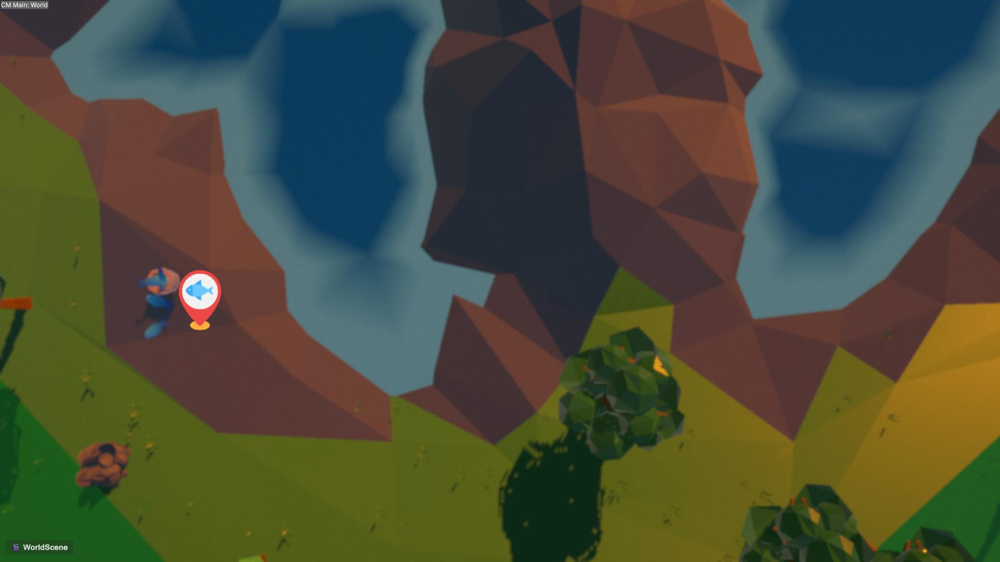
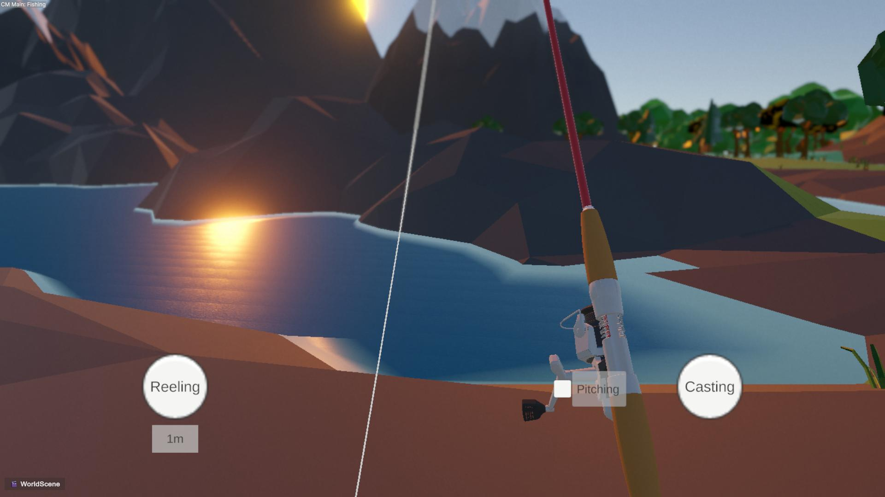
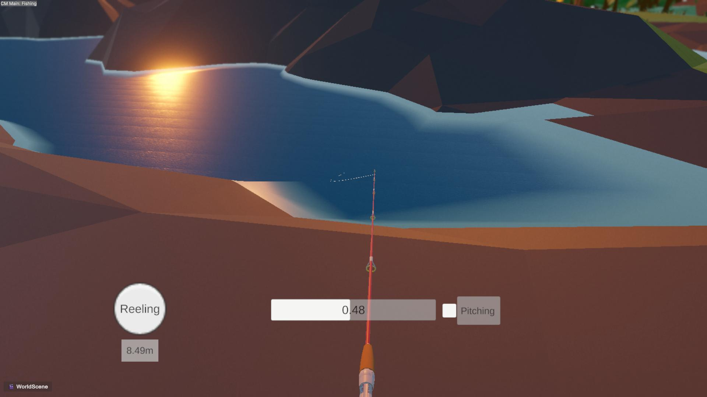
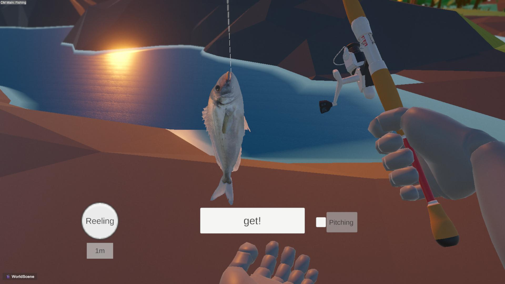

# 🎣 Project F - 3D 낚시 시뮬레이션 프로젝트

> **Verlet Integration 기반 로프 물리와 모듈화된 자체 C# 프레임워크(UPM Package) 기반의 낚시 시뮬레이션 프로젝트**

---

## 📌 프로젝트 소개
**Project F**는 캐스팅, 파이팅, 획득까지 이어지는 낚시 메커니즘을 사실적인 물리 시뮬레이션으로 구현한 3D 게임 프로젝트입니다.  
프로젝트 확장성과 재사용성을 고려해 **씬 전환, UI 관리, FSM 등 공통 핵심 시스템을 독립적인 UPM(Unity Package Manager) 프레임워크 패키지로 분리**하여 구축했습니다.

* **개발 환경:** Unity 3D, C#
* **주요 특징:** 
  * 독립된 C# Framework 패키지 분리 및 연동 (UPM 패키지화)
  * Verlet Integration 기반 낚싯줄 물리 연산
  * FSM 기반 플레이어 & 물고기 AI 상태 제어

---

## 🏗 시스템 아키텍처 및 자체 프레임워크 (Framework Package)

프로젝트 간 코드 재사용성과 유지보수성을 위해 공통 모듈을 독립적인 프레임워크 패키지(`ClimbGames Framework`)로 패키징하여 관리합니다.

## 🎮 주요 게임 플레이 흐름

| 1. 타이틀 & 비동기 씬 로딩 | 2. 월드 맵 & 스팟 이동 |
| :---: | :---: |
|  |  |
| Framework의 SceneTransition를 통한 씬 전환 | 월드 탐색 및 낚시 포인트 인터랙션 |

| 3. 캐스팅 & 릴링 메커니즘 | 4. 어획 (Fish Get) |
| :---: | :---: |
|  |  |  |
| Verlet 로프 기반 릴링 및 장력 조절 | 입질 감지 후 UIManager를 통한 결과 연출 |

## 🛠 핵심 기술 및 구현 상세

### 1. Verlet Integration 기반 낚싯줄(Rope) 물리 시스템
* **Verlet Line Algorithm:** 이전 위치와 현재 위치의 차이값을 이용해 낚싯줄 특유의 휘어짐과 속도 연산
* **Distance Constraint:** 노드 간 거리를 일정하게 유지하는 구속 조건을 반복 적용하여 자연스러운 팽팽함 표현
* **Dynamic Length Control:** 캐스팅/릴링 시 노드 개수를 동적으로 조절하여 실시간 줄 길이 제어

### 2. FSM (유한 상태 머신) 기반 개체 상태 관리
* **Player State:** `Idle` ➔ `Casting` ➔ `Waiting` ➔ `Fighting` ➔ `Catching`
* **Fish AI State:** `Idle` ➔ `Approach` ➔ `Bite` ➔ `Struggle` ➔ `Flee` / `Submit`
* 프레임워크의 FSM Core를 상속받아 구현함으로써 상태 전환 시 예외 처리를 단순화하고 코드 결합도를 감소시킴