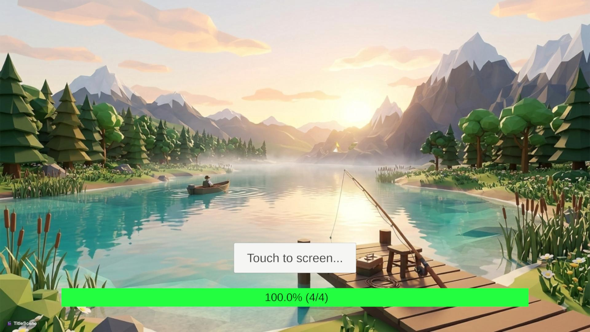

# 🎣 Project F - 3D 낚시 시뮬레이션 프로젝트

> **Verlet Integration 기반 로프 물리와 모듈화된 자체 C# 프레임워크(UPM Package) 기반의 낚시 시뮬레이션 프로젝트**

---

## 📌 프로젝트 소개
**Project F**는 캐스팅, 파이팅, 획득까지 이어지는 낚시 메커니즘을 사실적인 물리 시뮬레이션으로 구현한 3D 게임 프로젝트입니다.  
프로젝트 확장성과 재사용성을 고려해 **씬 전환, UI 관리, FSM 등 공통 핵심 시스템을 독립적인 UPM(Unity Package Manager) 프레임워크 패키지로 분리**하여 구축했습니다.

* **개발 환경:** Unity 3D, C#
* **주요 특징:** 
  * 독립된 C# Framework 패키지 분리 및 연동 (UPM 패키지화)
  * Verlet Integration 기반 낚싯줄 물리 연산
  * FSM 기반 플레이어 & 물고기 AI 상태 제어
* **조작법 (Controls):**
  * **캐릭터 이동:** 화면 좌측 터치 조이스틱 / 키보드 WASD
  * **시점 전환:** 화면 우측 터치 드래그

---

## 🏗 시스템 아키텍처 및 자체 프레임워크 (Framework Package)

프로젝트 간 코드 재사용성과 유지보수성을 위해 공통 모듈을 독립적인 프레임워크 패키지([ClimbGames Framework](https://github.com/donguk/climbgames-framework.git))로 패키징하여 관리합니다.

## 🎮 주요 플레이 흐름

| 1. 타이틀 & 비동기 씬 로딩 | 2. 월드 맵 & 스팟 이동 |
| :---: | :---: |
|  |  |
| Framework의 SceneTransition를 통한 씬 전환 | 월드 탐색 및 낚시 포인트 인터랙션 |

| 3. 캐스팅 포즈 | 4. 물고기와의 Fighintg | 4. 어획 (Fish Get) |
| :---: | :---: | :---: |
|  |  |  |
| Pitching - Overhead 전환 | 릴링 및 텐션 게이지 | 결과 연출 |

## 🛠 핵심 기술 및 구현 상세

### 1. Verlet Integration 기반 낚싯줄(Rope) 물리 시스템
* **Verlet Line Algorithm:** 이전 위치와 현재 위치의 차이값을 이용해 낚싯줄 특유의 휘어짐과 속도 연산
* **Distance Constraint:** 노드 간 거리를 일정하게 유지하는 구속 조건을 반복 적용하여 자연스러운 팽팽함 표현
* **Dynamic Length Control:** 캐스팅/릴링 시 노드 개수를 동적으로 조절하여 실시간 줄 길이 제어
* **Verlet Line 참고 영상:** [Make a custom rope (with collisions) using VERLET Integration (Unity Tutorial)](https://www.youtube.com/watch?v=bxG3XP4MVzk&t=1s)

### 2. FSM (유한 상태 머신) 기반 개체 상태 관리
* **Player State:** `Idle` ➔ `Casting` ➔ `Waiting` ➔ `Fighting` ➔ `Catching`
* **Fish AI State:** `Idle` ➔ `Approach` ➔ `Bite` ➔ `Struggle` ➔ `Flee` / `Submit`
* 프레임워크의 FSM Core를 상속받아 구현함으로써 상태 전환 시 예외 처리를 단순화하고 코드 결합도를 감소시킴

### 3. 성능 최적화 및 트러블슈팅 (Optimization & Troubleshooting)
* **Catmull-Rom Spline 기반 라인 연산 최적화 (Performance Optimization)**
  * **물리 노드 경량화:** 실시간 물리 연산에 사용되는 Verlet 질점(Node) 수를 최소화하여 CPU 연산 오버헤드 절감
  * **곡선 보간(Spline Interpolation):** 축소된 질점 사이를 **Catmull-Rom Spline** 알고리즘으로 보간하여 적은 연산량으로도 꺾임 없는 부드러운 낚싯줄 비주얼 구현

* **Execution Order 및 타임스텝 동기화를 통한 Jittering 방지 (Execution Order Optimization)**
  * **연산 순서 제어:** FSM의 `OnFixedUpdate` 내에서 `캐릭터 이동/회전` ➔ `라인 Verlet 시뮬레이션` 순으로 실행 스텝을 보장하여 1프레임 위치 오차 차단
  * **Cinemachine 카메라 동기화:** Cinemachine 카메라의 Update 방식을 `FixedUpdate`로 설정하여 **캐릭터 이동 - 라인 물리 연산 - 카메라 추적**이 동일한 `Time.fixedDeltaTime` 타임스텝 내에서 작동하도록 완벽 동기화
  * **FSM 수명주기 활용:** `ActorStateBase` 추상 클래스에 `OnFixedUpdate()`를 정의하여 상태별 물리 연산 루프를 깔끔하게 캡슐화